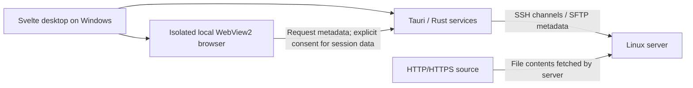

# SSH Virtual Desktop

A Windows desktop for a remote Linux server. Browse locally, run real SSH terminals, manage remote files over SFTP, and download files directly to Linux.

[](LICENSE)
[](https://github.com/madarlevi/ssh-virtual-desktop/releases)
[](https://github.com/madarlevi/ssh-virtual-desktop/actions/workflows/ci.yml)

Badges reflect GitHub's current state; this update has not been pushed and no GitHub build or release is claimed. Version **0.2.0** is prepared locally. See [QA.md](QA.md) for checks actually performed.

## Features

- KDE-inspired local desktop with taskbar, launcher, draggable/resizable application windows and persistent appearance.
- Shared SSH connection, first-use host fingerprint confirmation, changed-key rejection, password/private-key authentication and Windows Credential Manager.
- Real SSH PTY terminals with xterm.js, Unicode, resize and Bash prompt colors.
- SFTP file manager, server-side copy/move, text editor with conflict detection, depth-limited folder caching and automatic updates.
- Isolated native WebView2 browser, cookies and JavaScript, without iframe restrictions.
- Detached remote downloads, real byte progress, cancellation, retries and explicit opt-in request authentication.
- Windows NSIS/MSI packaging and tag-triggered GitHub releases.

## Architecture



**The client renders everything.** Linux runs only shell commands, PTYs, SFTP and download tools. No graphical desktop, remote browser, GPU, VNC, RDP, X11/Wayland forwarding, screen streaming, WSL, Docker or permanent custom daemon is required.

The frontend lives in `src/components/`, with typed RPC in `src/lib/api.ts`. Rust separates SSH (`ssh.rs`), SFTP (`files.rs`), cache (`directory_cache.rs`), terminals (`terminal_shell.rs`), native browser observation (`browser_requests.rs`), bounded request storage/validation (`download_request.rs`), download workers (`downloads.rs`) and settings/vault (`store.rs`). Untrusted websites have no privileged RPC access.

## Screenshots

Connected-session screenshots will be added after interactive Windows/Linux verification. No mock screenshots or fabricated terminal/file data are included. The original release connection screen was inspected; current verification limits are recorded in [QA.md](QA.md).

## Windows requirements

- Windows 10/11 x64 and a working network route to the Linux SSH service.
- Microsoft Edge **Evergreen WebView2 Runtime**. The installers run Microsoft's runtime bootstrapper if missing; internet access may be needed.
- No Rust, Node.js, compiler or local Linux installation is needed to run an installer build.

## Linux requirements

OpenSSH server with SFTP, a POSIX-compatible shell and normal utilities on Debian, Ubuntu, Fedora or Arch. No root access is needed for ordinary use.

Downloads need **aria2c**, **wget** or **curl**, plus `setsid`, `nohup`, `sh`, `wc`, `ln`, `mv`, `mkdir`, `date`, `sleep`, `rm`, `cat`, `tail`, `rmdir` and `chmod`. Header-bearing/authenticated requests and POST require **curl**. Server-side copy needs GNU-compatible `cp`; atomic download publication needs hard links and GNU-compatible `ln -T`. The app detects missing tools and never installs packages automatically.

## Install

1. Open [GitHub Releases](https://github.com/madarlevi/ssh-virtual-desktop/releases). Until a maintainer pushes a version tag and its workflow finishes, there may be no downloadable release.
2. Download the Windows x64 `*-setup.exe` (NSIS) or `.msi` installer and optionally verify `SHA256SUMS.txt` with `Get-FileHash`.
3. Run the installer. NSIS installs per user; the MSI may require elevation. Use its Start Menu shortcut to launch the app. Windows Settings provides normal uninstallation.
4. Allow WebView2 setup if the runtime is missing.

These builds are **unsigned**. Windows SmartScreen may display an unknown-publisher warning or block execution under organizational policy. Verify the repository, release and checksum; do not bypass a policy you do not control. No signing certificate is bundled or implied.

## Connect to SSH

Enter hostname/IP, port (22 by default), Linux username and password or OpenSSH private-key path/passphrase. The first connection stops before authentication and displays a SHA-256 host-key fingerprint. Compare it through a trusted channel, for example the server's `ssh-keygen -lf /etc/ssh/ssh_host_ed25519_key.pub`, before trusting it. A changed key blocks connection; there is no bypass button.

Profiles, pinned fingerprints and appearance are in `%APPDATA%\dev.sshvirtualdesktop.app\settings.json`. Selected passwords/passphrases are kept in **Windows Credential Manager**, never that settings file. Private keys remain at their original local path. Do not commit settings, profiles, keys or credentials. Reconnect is user initiated; old PTYs cannot be resumed after SSH drops. Detached download jobs are rediscovered separately.

## Browser and server-side downloads

Open Browser from the taskbar and navigate with its address bar. This is an actual Windows WebView2 child view; websites render locally. Clicking a supported download opens the SFTP destination picker. Alternatively use **Downloads → New download** for a direct URL.

Choose the remote directory and filename. In **Advanced Download Options**, review the HTTP method, header count, cookie forwarding status, authentication indicator and selected backend. Use **Check request & backend**, then **Download to Server**.

Authentication forwarding is **off by default**. The checkbox **Allow forwarding required authentication data to the remote server for this download** approves only this request. The remote server temporarily receives the approved session information and may gain access to that session: use a trusted server. Captured secret values stay native; the UI shows counts and names. Only cookies actually observed on the corresponding native request are eligible. The browser cookie database is never exported.

With no consent, sensitive headers/cookies are omitted and POST is blocked. Explicit manual headers and UTF-8 POST bodies are supported. Forwarded authentication and POST require HTTPS. If WebView2 cannot expose a complete replayable body, the request is blocked rather than changed to GET. Replaying a POST can repeat a server-side action already performed by the browser.

Public GET selects aria2c, then wget, then curl, with bounded retries. Advanced requests use curl and private SFTP request files, never credential-bearing command arguments. Authenticated/POST redirects stop; open the target in the browser and approve a new request. Cross-origin credentials are never forwarded automatically. Expired, IP-bound, client-certificate and anti-bot sessions can fail. Blob/data/browser-generated files cannot generally be delegated. No local-download-and-upload fallback is silently used or currently offered.

File contents flow **website → Linux server → destination**. Progress is real remote partial-file size; speed derives from byte samples and total/percentage are shown only when available. Browser interception may happen after some network buffering. Jobs survive client disconnect when server policy allows, not server reboot or processes being killed. Credential files are removed on normal worker exit/cancel; crashes/SIGKILL may require manual cleanup. Separate-job resume is not implemented; Retry starts a fresh transfer. Authenticated/header/body requests need recapture and approval.

See [download architecture and API limitations](docs/downloads.md) and [security policy](SECURITY.md).

## File manager and editor

Browse with breadcrumbs, the path field or back/forward/parent buttons. Create folders; select items to rename, copy, move or delete. Delete is confirmed and supports files or empty folders. Copy remains on Linux using `cp -a --no-clobber`; it does not relay file contents through Windows.

**Scan & cache** takes a numeric depth: 0 caches only the current folder; 1 includes immediate subfolders; maximum 16. Shared metadata stays in RAM for the SSH connection. Scans repeat 30 seconds after each pass and update open views when entries change. File operations invalidate affected listings. **Reload** fetches the current folder directly from SFTP. **Stop cache** clears it. A pass is bounded to 2,000 folders, 100,000 entries and two minutes; errors/limits show a partial-cache status. Directory symlinks are not followed during scans.

Double-click a supported UTF-8 text file to edit it locally and save over SFTP. The editor limits files to 2 MiB, rejects obvious binary content, warns about unsaved changes and checks for remote modification conflicts. Atomic replacement preserves Unix mode bits, but not inode identity, hard links, ACLs or extended attributes; a small compare/save race remains possible.

## Terminal

Each window opens a real SSH PTY and the remote user's default shell. Bash 4.4+ displays the folder in green, submitted commands in red, ordinary output in blue and current input in white. The header tracks the actual remote working directory. A private temporary startup file loads `~/.bashrc`, installs session-only prompt hooks and removes itself; persistent shell configuration is not edited. Bash sessions are interactive/non-login. Other shells retain their native prompt/colors. ANSI colors and full-screen terminal applications keep their behavior.

Copy with **Ctrl+Shift+C**, paste with **Ctrl+Shift+V**. File Manager's **Open Terminal Here** opens a shell in that remote directory.

## Appearance

Open Appearance in the launcher to change accent, light/dark theme, desktop/taskbar/window colors and local wallpaper. Changes apply immediately and persist locally. Wallpaper bytes stay on Windows (8 MiB maximum), never Linux. Reset to Defaults restores the built-in appearance.

## Development

Install Node.js **24**, stable Rust with `x86_64-pc-windows-msvc`, Visual Studio 2022 or newer **Desktop development with C++** plus Windows SDK, and WebView2. Open PowerShell:

```powershell
git clone https://github.com/madarlevi/ssh-virtual-desktop.git
cd ssh-virtual-desktop
npm ci
npm run tauri dev
```

```powershell
npm run versions:check
npm run workflows:check
npm run check
npm run test:ui
cargo fmt --check --manifest-path src-tauri/Cargo.toml
cargo clippy --locked --manifest-path src-tauri/Cargo.toml --all-targets -- -D warnings
cargo test --locked --manifest-path src-tauri/Cargo.toml
npm run build
```

Tests use synthetic sessions and controlled HTTP fixtures. They do not need production secrets. Shell worker tests require Git for Windows' POSIX tools on Windows and skip their bodies if no shell is installed; read the verification record before claiming coverage.

## Windows build and packaging

```powershell
npm run tauri build
# Explicit installer selection:
npm run tauri build -- --bundles nsis,msi
```

The standalone application is `src-tauri/target/release/ssh-virtual-desktop.exe`. It is **not** an installer. NSIS installers are under `src-tauri/target/release/bundle/nsis/*-setup.exe`; MSI installers are under `src-tauri/target/release/bundle/msi/*.msi`. Tauri downloads/validates NSIS/WiX tools when needed. Both include the configured app icon, publisher/version metadata, Start Menu integration, uninstallation and WebView2 handling. Build outputs, generated schemas, installers, node_modules and caches are ignored by Git; lockfiles are tracked.

Regenerate third-party notices after dependency changes:

```powershell
cargo metadata --locked --format-version 1 --filter-platform x86_64-pc-windows-msvc --manifest-path src-tauri/Cargo.toml > .build-cache/cargo-metadata.json
node scripts/licenses.mjs
```

Create `.build-cache` first if absent. Review changed notices and MPL source copies; do not remove attribution. Dependencies keep their own licenses; see [THIRD_PARTY_NOTICES.md](THIRD_PARTY_NOTICES.md).

## Create a release

1. Complete the checks and live smoke tests; update CHANGELOG and review the dependency notices.
2. Synchronize all manifests and lockfiles with `npm run version:set -- 0.2.0`, then `npm run versions:check`.
3. Commit and push reviewed changes to `main`. Create a tag matching that exact version:

```powershell
git tag v0.2.0
git push origin v0.2.0
```

For example, for an application whose manifests actually say `0.1.0`, the exact commands are:

```powershell
git tag v0.1.0
git push origin v0.1.0
```

**Do not tag this 0.2.0 checkout as v0.1.0.** The release workflow fails if the tag differs from package.json, Cargo.toml, tauri.conf.json or either lockfile. Tags such as `v0.3.0-beta.1` produce prereleases.

Pushing `v*` triggers `.github/workflows/release.yml`: checks, a Windows build, verified NSIS/MSI installers, SHA-256 checksums, then GitHub-generated release notes and actual installer uploads using `GITHUB_TOKEN`. No personal access token is needed. Publishing occurs only after the `release` environment's configured approval. A failed build never publishes placeholders. This update itself does not push a tag or publish a release.

Repository settings: enable Actions, create an environment named **release** with required reviewers and deployment-tag rules for `v*`, protect `main` with the CI check, enable private vulnerability reporting, and allow the publish job's scoped `contents: write` permission. No SSH account/production secrets are required. Organization policies may need to permit the pinned actions and GitHub Releases. See [CONTRIBUTING.md](CONTRIBUTING.md).

## Security and limitations

Read [SECURITY.md](SECURITY.md) before forwarding authentication. Host keys are pinned; untrusted browser views have no privileged capabilities. Never weaken IPC origin/label checks or add wildcard remote capabilities. Secrets belong in the OS vault or approved temporary private server files, never logs or repository files.

Native child WebViews use Tauri's stable 2.x release with its `unstable` multi-WebView feature. Windows native airspace means only the focused browser surface is shown; dialogs/launcher hide it while pages remain alive. Popups and website permission requests are denied. High-DPI, window layering, SSH cleanup and clean-machine installation still require real-device checks. No audit, code signing, clean-VM verification or site-universal authenticated replay is claimed. [QA.md](QA.md) separates build/unit checks from unverified connected workflows.

## Roadmap

- Complete Windows/Linux acceptance checks and add verified screenshots.
- Add validator-safe resume and explicit origin-reviewed redirect continuation.
- Improve native download correlation, error diagnostics and site compatibility without exposing credentials.
- Sign release installers when a maintainer-provided certificate is available.

## Contributing and license

Issues and pull requests are welcome. Follow [CONTRIBUTING.md](CONTRIBUTING.md), use the provided templates, and report vulnerabilities privately under [SECURITY.md](SECURITY.md).

Copyright © 2026 **Madár Levente (madarlevi)**. Application source and original icon are provided under the [MIT License](LICENSE). Third-party dependencies and bundled notices retain their own licenses; MPL-covered dependency sources are included separately.
